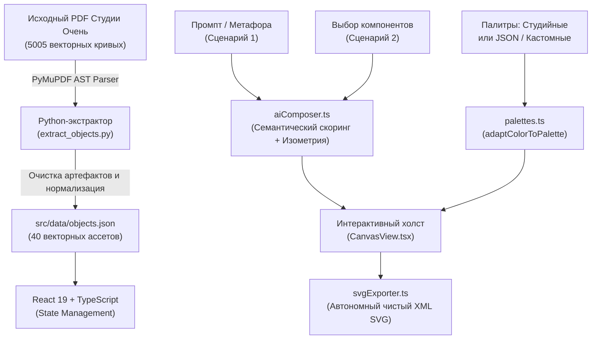

# Очень. Компоновщик - Генератор изометрических иллюстраций

Веб-сервис для автоматизированной и интерактивной сборки изометрических иллюстраций из векторной библиотеки компонентов по дизайн-системе Студии «Очень».

Разработано в рамках тестового задания на позицию **Junior AI Developer**.

---

## Демонстрация и ссылки

- **Демо сервиса (Vercel):** [https://ochen-composer.vercel.app](https://ochen-composer.vercel.app) *(деплой в 1 клик через Vercel / Netlify)*
- **Репозиторий GitHub:** [https://github.com/raviollly88/ochen-composer](https://github.com/raviollly88/ochen-composer)
- **Локальный запуск:**
  ```bash
  git clone https://github.com/raviollly88/ochen-composer.git
  cd ochen-composer
  npm install
  npm run dev
  ```

---

## Реализация требований тестового задания

### 1. Сценарий 1: Генерация по метафоре или заголовку (AI / Semantics)
- Пользователь вводит заголовок статьи, тему или метафору (например, *"Личные финансы и инвестиции"*, *"Запуск IT-стартапа"*, *"Учеба и фокус на знаниях"*).
- Семантический анализатор ранжирует библиотеку компонентов по ключевым тегам и смысловым ассоциациям.
- Алгоритм автоматически рассчитывает гармоничную изометрическую сцену:
  - Выделяет смысловую доминанту (главный полноцветный объект первого плана).
  - Размещает поддерживающие элементы второго плана.
  - Добавляет монохромные фоновые объекты для создания глубины.
  - Подбирает рекомендуемую цветовую схему и отображает объяснение принятого решения (AI Rationale).

### 2. Сценарий 2: Сборка из выбранных компонентов
- Каталог всех исходных компонентов студии: 10 типов объектов в двух размерах детализации (L и S) и двух состояниях (Главный / Цветной и Фоновый / Монохромный).
- Поддерживается как одиночный клик для добавления на холст, так и пакетный выбор (чекбоксы) с последующей кнопкой *"Скомпоновать выбранные"*.

### 3. Интерактивный редактор холста
- **Drag-and-drop:** свободное перетаскивание объектов курсором или тачем.
- **Масштабирование:** ползунок масштаба со строгим сохранением пропорций (требование: *"нельзя менять пропорции объектов относительно друг друга"*).
- **Поворот:** точная настройка угла поворота с шагом 15° и быстрым сбросом в 0°.
- **Слои (Z-Index):** вынос на передний план и отправка на задний план.
- **Состояние элемента:** переключение между цветным (главным) и монохромным (фоновым) состоянием в один клик.
- **Дублирование и удаление:** быстрое клонирование объектов со смещением или удаление с холста.
- **Форматы холста:** мгновенное переключение между 16:9 (баннер), 1:1 (квадрат), 9:16 (Stories/Reels) и 4:3 (карточка).

### 4. Динамическая работа с цветовыми палитрами
- Реализованы 3 фирменные палитры студии:
  - **Purple Mist** (Фиолетовая: фон `#d7cdf5`, тень `#7864d7`)
  - **Warm Peach** (Персиковая: фон `#fdd7b9`, тень `#d27532`)
  - **Fresh Mint** (Мятная: фон `#beebeb`, тень `#5abebe`)
- **Загрузка и настройка палитр (JSON / HEX):**
  - Поддерживается импорт пользовательских файлов палитр в формате JSON (как в Figma-плагинах).
  - Встроен интерактивный редактор цветов с пикером HEX для создания собственных гармоничных схем.
  - Экспорт активной палитры в JSON в 1 клик.
- **Строгое соблюдение дизайн-правил студии:**
  - Цвета фона могут использоваться в объектах, цвета акцентов объектов не могут попадать в фон.
  - Обводки (`#181817`) и чистый белый цвет бликов (`#ffffff`) остаются неизменными.
  - Фоновые монохромные объекты автоматически перекрашиваются в градиентные градации активной палитры.

### 5. Экспорт в векторный SVG
- Генератор компилирует чистый автономный XML SVG без внедренных растровых изображений (base64 или png).
- Сохраняются оригинальные кривые, правила заливки (`evenodd`), порядок слоев и скругления.
- Файл готов к открытию в Figma, Adobe Illustrator или прямому встраиванию в веб-код.

---

## Архитектура: извлечение, хранение и переиспользование SVG



### 1. Извлечение элементов (Extraction)
- Исходный PDF-файл содержал 5005 векторных путей. С помощью скрипта на Python и библиотеки PyMuPDF был выполнен синтаксический анализ структуры документа.
- Объекты были сгруппированы по координатным кластерам и именам (`phone`, `notebook`, `puzzle`, `coin`, `headphones`, `lamp`, `flowers`, `wallet`, `folder`, `pen`) в двух размерах (L, S) и двух состояниях (main, bg), что дало ровно **40 канонических векторных элементов**.
- Были отфильтрованы служебные границы монтажных областей Figma, а координаты нормализованы относительно локальных bounding boxes с сохранением центра вращения (`ox`, `oy`).

### 2. Хранение элементов (Storage)
- Все векторные элементы хранятся в структурированном виде в файле `src/data/objects.json`.
- Каждый объект описывается интерфейсом:
  ```typescript
  interface AssetMeta {
    id: string;        // 'notebook-L-main'
    object: string;    // 'notebook'
    size: 'L' | 'S';
    state: 'main' | 'bg';
    w: number;         // ширина bounding box
    h: number;         // высота bounding box
    paths: {
      d: string;       // SVG path data
      fill: string;    // оригинальный HEX цвет заливки
      eo?: boolean;    // fill-rule='evenodd'
      op?: number;     // fill-opacity
    }[];
  }
  ```
- Такой формат обеспечивает мгновенную загрузку приложения без необходимости делать десятки сетевых HTTP-запросов за отдельными файлами и решает проблемы с CORS.

### 3. Переиспользование и динамическая перекраска (Reuse & Dynamic Recoloring)
- Переиспользование реализовано по принципу виртуальных инстансов: на холсте хранится массив легких структур `CanvasItem` (тип объекта, размер, координаты `x, y`, масштаб `scale`, угол `rotation`, `zIndex`).
- При рендеринге движок берет геометрию из каталога и на лету применяет чистую функцию `adaptColorToPalette(fill, activePalette, isMonochrome)`.
- Исходные данные в `objects.json` остаются неизменяемыми (immutable), что гарантирует отсутствие эффекта деградации цветов при многократном переключении тем.

---

## Использованные AI-инструменты

В разработке проекта применялся AI-first подход:
1. **Claude 3.5 Sonnet / Antigravity:**
   - Архитектурное проектирование структуры проекта, типизация предметной области на TypeScript.
   - Разработка математической модели изометрической проекции с учетом безопасных отступов и центрирования макета.
   - Разработка семантического анализатора текста для сценария метафор (сопоставление весов тегов, определение ролей элементов).
   - Автоматизация очистки и калибровки векторных кривых из PDF.

---

## Примеры собранных композиций

Все три примера сгенерированы в сервисе и доступны в форматах `.svg` и `.png` в папке `public/samples/`:

### Пример 1. Квадрат 1:1 - "Учеба и конспекты" (Purple Mist)
- **Идея:** Открытый блокнот в фокусе первого плана, стилус на развороте страниц и монохромная папка документов в правом верхнем фоне. Фирменная фиолетовая палитра студии с диагональными штрихами и мягким эллипсом тени.
- **Файлы:** [sample-1.svg](public/samples/sample-1.svg) | [Превью PNG](public/samples/sample-1.png)


---

### Пример 2. Квадрат 1:1 - "Личные финансы и бюджет" (Warm Peach)
- **Идея:** Классическая финансовая метафора: папка документов в фоне, детализированный кожаный кошелек на первом плане и золотая монета на столе вдоль 30-градусной изометрической оси. Теплая персиковая палитра с круговым акцентом.
- **Файлы:** [sample-2.svg](public/samples/sample-2.svg) | [Превью PNG](public/samples/sample-2.png)


---

### Пример 3. Квадрат 1:1 - "Музыка и отдых" (Fresh Mint)
- **Идея:** Лаконичная сцена отдыха и вдохновения: крупные наушники на первом плане и ваза с тюльпанами в фоновой глубине. Свежая мятная цветовая схема с гармоничным свободным пространством.
- **Файлы:** [sample-3.svg](public/samples/sample-3.svg) | [Превью PNG](public/samples/sample-3.png)


---

## Стек технологий

- **Фреймворк:** React 19 + TypeScript + Vite
- **Стилизация:** Tailwind CSS
- **Векторная графика:** Pure SVG DOM Rendering + XML Serializer
- **Иконки:** Lucide React
- **Инструменты парсинга:** Python + PyMuPDF (fitz)
